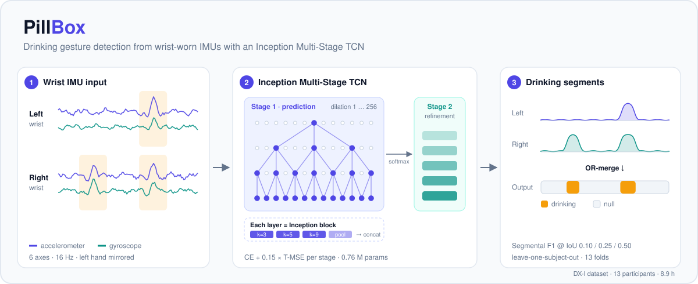

# PillBox

**Drinking gesture detection from wrist-worn IMUs with Inception-based Multi-Stage Temporal Convolutional Networks**

*Diploma thesis project, work in progress*

<p align="center">
  
</p>

---

## Abstract

Monitoring fluid intake automatically matters for elderly care, for chronic conditions, and as a building block for medication-adherence systems. Wrist-worn inertial sensors are an unobtrusive way to do it, but drinking gestures are short, sparse (under 4% of the recorded time), and easy to confuse with other hand-to-mouth activities such as eating or smoking.

The project has two parts. First, it reproduces the Multi-Stage Temporal Convolutional Network (MS-TCN) of Wang et al. (EMBC 2022). That model labels every time step of a continuous IMU stream as *drinking* or *null*, and reports a segmental F1 of 0.943 on the DX-I dataset. Second, it studies an architectural extension: each dilated residual layer is replaced by an **Inception dilated layer**, a set of parallel convolutions with different kernel sizes. The idea is borrowed from InceptionTime and TCN-Inception, and lets each layer capture motion patterns at several time scales at once.

All models are evaluated under the same leave-one-subject-out protocol, and a step-by-step ablation measures each design choice on its own.

---

## Contents
- [Background](#background)
- [Dataset](#dataset)
- [Method](#method)
- [Evaluation protocol](#evaluation-protocol)
- [Results](#results)
- [Getting started](#getting-started)
- [Repository structure](#repository-structure)
- [References](#references)
- [Acknowledgements](#acknowledgements)

---

## Background

**MS-TCN** (Farha & Gall, 2019) segments a sequence into actions by stacking several stages of dilated temporal convolutions. Each stage refines the frame-wise predictions of the previous one, which reduces over-segmentation. Wang et al. (2022) applied it to drinking detection with two wrist IMUs and showed that it beats sliding-window classifiers in free-living conditions.

**Inception modules** (Szegedy et al., 2015) run convolutions of several kernel sizes side by side and concatenate their outputs. InceptionTime (Ismail Fawaz et al., 2020) carried this design over to time-series classification and found that longer kernels and a bottleneck projection work well for sensor data. This thesis asks whether the same multi-scale receptive field helps dense, frame-level gesture segmentation.

---

## Dataset

The project uses **DX-I** from the public drinking-gesture dataset released with Wang et al. (2022).

| Property | Value |
|---|---|
| Sensors | 2 × Shimmer3 IMUs (left and right wrist), 3-axis accelerometer + 3-axis gyroscope |
| Sampling rate | 64 Hz |
| Participants | 13 (15 recordings) |
| Duration | 8.9 h, semi-controlled (home and office) |
| Drinking gestures | 410 (left : right : both hands = 101 : 266 : 43) |
| Confounding activities | laptop work, talking, walking, eating, smoking, watching TV |

The raw data is not included in this repository. Download it from the dataset's Dataverse page and place it under `dataverse_files/`.

---

## Method

### Preprocessing
1. **Hand mirroring:** the left-wrist signals are mirrored (ax, gy, gz × −1), so one model serves both hands.
2. **Anti-aliasing:** a 4th-order zero-phase Butterworth low-pass filter at 7.5 Hz.
3. **Downsampling:** from 64 Hz to 16 Hz.
4. **Normalisation:** z-score per session.

### Baseline: MS-TCN

| Component | Configuration |
|---|---|
| Stages | 2 (prediction + refinement) |
| Layers per stage | 9 dilated residual layers, dilation 2⁰ … 2⁸ |
| Filters / kernel | 128 / 3, non-causal, dropout 0.3 |
| Receptive field | 1023 samples (≈ 64 s) per stage |
| Refinement input | softmax of the previous stage |

### Proposed: Inception MS-TCN
Each dilated residual layer is replaced by an Inception dilated layer:

```
                                  ┌─ dilated conv k=3 ─┐
        ┌─ 1×1 bottleneck (32) ───┼─ dilated conv k=5 ─┤
        │                         └─ dilated conv k=9 ─┼─ concat ─ ReLU ─ 1×1 ─ dropout ─ (+) ─ output
input ──┼─ max-pool (3) ─ 1×1 ─────────────────────────┘                                  │
        └──────────────────────────────── residual ───────────────────────────────────────┘
```

Every other setting (stages, dilation schedule, loss, optimiser) is identical to the baseline, so a difference in results can be attributed to the layer design. The resulting model has about 36% fewer parameters (0.76 M vs 1.19 M).

### Training objective
For each stage, the loss is cross-entropy plus 0.15 × truncated MSE (τ = 4) on log-probabilities. The truncated-MSE term smooths the predictions. The per-stage losses are summed. Optimisation uses Adam (lr 5·10⁻⁴) for 50 epochs on whole sessions, with batch size 1 and a fixed seed.

---

## Evaluation protocol

- **Leave-one-subject-out** cross-validation (13 folds). Folds are grouped by participant, not by recording, so no subject appears in both training and test data.
- **Left/right fusion:** the frame-wise predictions of the two wrists are OR-merged per recording, matching the paper.
- **Metric:** segmental F1 at IoU thresholds k ∈ {0.10, 0.25, 0.50}, with TP/FP/FN pooled over all folds.
- **Model selection:** the last epoch is reported. The held-out subject is never used for training or for picking a checkpoint.

---

## Results

### Reference (Wang et al., 2022, DX-I)

| k | TP | FP | FN | Segmental F1 |
|---|---|---|---|---|
| 0.10 | 401 | 28 | 9 | 0.956 |
| 0.25 | 400 | 29 | 9 | 0.955 |
| 0.50 | 391 | 32 | 15 | 0.943 |

### Ablation study

Each row changes one factor relative to its parent.

| ID | Model | Change | Params | F1@0.10 | F1@0.25 | F1@0.50 |
|---|---|---|---|---|---|---|
| A | MS-TCN | Reproduction of the paper | 1.19 M | — | — | — |
| B | Inception MS-TCN | Inception layers in all stages | 0.76 M | — | — | — |
| C | Inception MS-TCN | Inception layers in stage 1 only | — | — | — | — |
| D | Inception MS-TCN | Longer kernels (3 / 9 / 17) | — | — | — | — |
| E | Inception MS-TCN | Without the max-pool branch | — | — | — | — |
| F | Best of A–E | Three stages | — | — | — | — |
| G | Best | 9 input channels (+ magnitudes, jerk) | — | — | — | — |
| H | Best | Square-root inverse class weights | — | — | — | — |

*Results will be added as the experiments finish. The detailed experiment log is in [`EXPERIMENTS.md`](EXPERIMENTS.md).*

---

## Getting started

### Requirements
- Python 3.11
- PyTorch 2.5 (CUDA recommended; experiments ran on an NVIDIA RTX 4060 Ti 16 GB)
- NumPy, SciPy, pandas, Matplotlib, tqdm

```bash
git clone https://github.com/asoulios97/PillBox.git
cd PillBox
python -m venv .venv
pip install torch numpy scipy pandas matplotlib tqdm
```

### Preprocessing

```bash
cd code
python prepromax.py
```

### Tests

```bash
python test_mstcn_pipeline.py
```

### Training and evaluation

```bash
# Baseline MS-TCN (paper reproduction)
python mstcn_pipeline.py --preset paper --tag A_paper

# Inception MS-TCN
python mstcn_pipeline.py --preset paper_inception --tag B_inception
```

The available presets are `paper`, `paper_inception`, `paper_inception_s1` and `legacy`. Any hyperparameter can be overridden from the command line (`python mstcn_pipeline.py --help`). Each run writes its configuration, per-fold metrics, a summary and training curves to its own folder under `code/results/`.

---

## Repository structure

```
PillBox/
├── code/
│   ├── prepromax.py                     # preprocessing: raw 64 Hz → 16 Hz sessions
│   ├── mstcn_pipeline.py                # models, training, LOSO evaluation, metrics
│   ├── plot_results.py                  # training curves per run
│   ├── test_mstcn_pipeline.py           # unit and end-to-end tests
│   ├── sanity_check_transformations.py  # preprocessing checks
│   ├── results/                         # experiment outputs
│   └── legacy/                          # earlier prototypes, kept for reference
├── dataverse_files/                     # raw DX-I data (not tracked)
├── tcn inception/                       # related literature
├── EXPERIMENTS.md                       # experiment log
├── REPLICATION_PLAN.md                  # replication specification
└── README.md
```

---

## References

1. Wang et al., "Drinking Gesture Detection Using Wrist-Worn IMU Sensors with Multi-Stage Temporal Convolutional Network in Free-Living Environments," *IEEE EMBC*, 2022.
2. Y. Abu Farha and J. Gall, "MS-TCN: Multi-Stage Temporal Convolutional Network for Action Segmentation," *CVPR*, 2019.
3. H. Ismail Fawaz et al., "InceptionTime: Finding AlexNet for Time Series Classification," *Data Mining and Knowledge Discovery*, 2020.
4. C. Szegedy et al., "Going Deeper with Convolutions," *CVPR*, 2015.

---

## Acknowledgements

Thanks to the authors of Wang et al. (2022) for making the drinking-gesture dataset publicly available.
